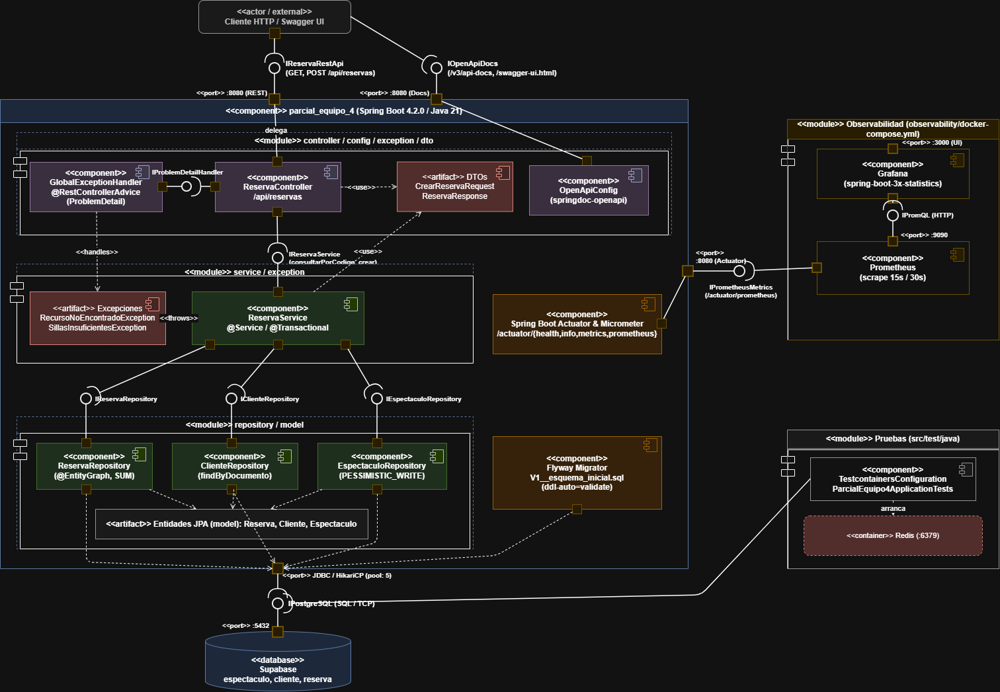
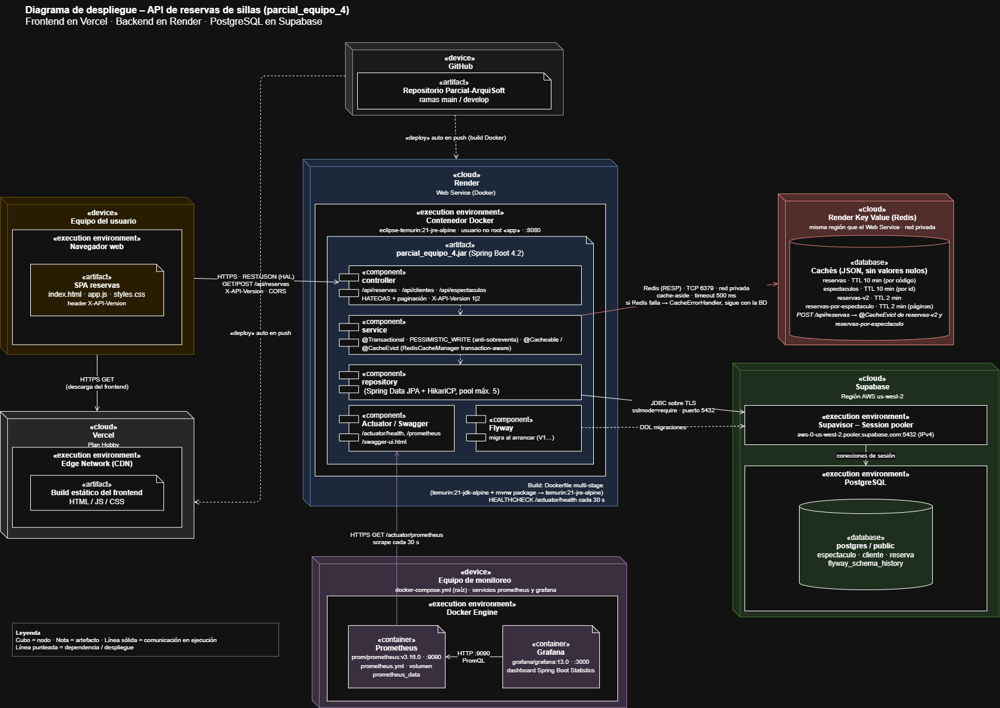

# API de Reservas de Sillas para Conciertos

API RESTful para la gestión y consulta de reservas de sillas por espectáculo, desarrollada por el **Equipo 4** para el curso de **Arquitectura de Software** (Universidad de Antioquia).

---

## Cumplimiento del enunciado

| # | Requisito | Cómo se cumple |
|---|---|---|
| 1 | GET que consulta la reserva por código | `GET /api/reservas?codigo=RES-XXXXXXXX` ([evidencia](#2-consultar-la-reserva-por-código-requisito-1)) |
| 2 | POST para crear una reserva | `POST /api/reservas` con `clienteId`, `espectaculoId` y `cantidadSillas` (1 a 10) ([evidencia](#1-crear-la-reserva-requisito-2)) |
| 3 | Base de datos con entidades Espectáculo, Cliente y Reserva | PostgreSQL (Supabase) con esquema versionado en Flyway |
| 4 | Documentación OpenAPI / Swagger | `/swagger-ui.html`, un grupo por versión de la API |
| 5 | Respuestas JSON | `application/hal+json` y errores `application/problem+json` (RFC 9457) |
| 6 | Versionamiento con *custom request header* | Header `X-API-Version` (versiones `1` y `2`) |
| 7 | HATEOAS | Enlaces `self`, `cliente`, `espectaculo`, `reservas` y de paginación |
| 8 | Códigos de estado HTTP | 200, 201 (+ `Location`), 400, 404, 409, 500 |
| 9 | Evidencias de funcionamiento y pruebas | [Evidencias](#evidencias-de-funcionamiento) + 40+ pruebas automatizadas en CI |
| 10 | Repositorio GitHub | https://github.com/miguemcu/Parcial-ArquiSoft |
| 11 | Diagrama de arquitectura | [Componentes UML](#diagrama-de-componentes) y [despliegue](#diagrama-de-despliegue) |
| 12 | Contenedores Docker | `Dockerfile` multi-stage + `docker-compose.yml` |
| 13 | Observabilidad | Actuator + Micrometer → Prometheus → Grafana (dashboard versionado) |
| 14 | Caché y paginación | Redis con TTL por caché; listados con `page` y `size` (`PagedModel`) |
| Extra | Frontend | Interfaz web estática servida en `/` |

---

## Stack tecnológico

| Área | Tecnología |
|---|---|
| Lenguaje | Java 21 |
| Framework | Spring Boot 4.2.0 (Maven) |
| Persistencia | Spring Data JPA + PostgreSQL + HikariCP |
| Migraciones | Flyway (`V1__esquema_inicial.sql`) |
| Caché | Spring Cache + Redis (serialización JSON tipada) |
| API y contratos | Spring Web MVC, Spring HATEOAS, Jakarta Validation, springdoc-openapi |
| Observabilidad | Spring Boot Actuator + Micrometer (Prometheus) |
| Pruebas | JUnit 5, Mockito, H2 (modo PostgreSQL), Testcontainers |
| CI y calidad | GitHub Actions, JaCoCo, SonarCloud |
| Utilidades | Lombok |

---

## Modelo de dominio y reglas de negocio

El esquema relacional (gestionado por Flyway en [`src/main/resources/db/migration/V1__esquema_inicial.sql`](src/main/resources/db/migration/V1__esquema_inicial.sql)) define tres entidades principales:

- **`espectaculo`**: `id`, `nombre`, `fecha`, `cantidad_sillas` (capacidad total `>= 0`).
- **`cliente`**: `id`, `nombre`, `documento` (único), `telefono`.
- **`reserva`**: `id`, `codigo_reserva` (único, máx. 20 caracteres), `cliente_id`, `espectaculo_id`, `cantidad_sillas` (`> 0`).

Reglas principales:
- **Disponibilidad agregada**: no se asignan sillas individuales; los cupos disponibles se calculan como `espectaculo.cantidad_sillas - SUM(reserva.cantidad_sillas)`.
- **Control de concurrencia**: al crear una reserva, la fila del espectáculo se bloquea con `PESSIMISTIC_WRITE` dentro de una transacción (`@Transactional`) para evitar sobreventa.
- **Código de reserva**: se genera con el formato `RES-` seguido de 8 caracteres alfanuméricos en mayúscula, validando unicidad antes de persistir.

---

## Arquitectura

El proyecto sigue una arquitectura en capas bajo el paquete base `com.udea.parcial_equipo_4`:

```text
controller  ──▶  service  ──▶  repository  ──▶  PostgreSQL / Redis
     │              │
     ▼              ▼
    dto           model (entidades JPA)
```

- **`controller`**: controladores REST delgados (`ReservaController`, `ClienteController`, `EspectaculoController`) y ensamblador HATEOAS (`ReservaModelAssembler`).
- **`service`**: lógica de negocio, transacciones, mapeo DTO (`ReservaMapper`) y caché (`ReservaService`, `ClienteService`, `EspectaculoService`, `ReservaPageCacheService`).
- **`repository`**: interfaces Spring Data JPA (`ReservaRepository`, `ClienteRepository`, `EspectaculoRepository`).
- **`dto`**: `record`s inmutables de entrada/salida con validaciones Jakarta.
- **`model`**: entidades JPA con relaciones `LAZY`.
- **`exception`**: excepciones de dominio y manejo centralizado con `GlobalExceptionHandler` (`@RestControllerAdvice`) usando `ProblemDetail` (RFC 9457).
- **`config`**: configuración de versionamiento (`ApiVersionConfig`), caché Redis (`CacheConfig`), CORS (`CorsConfig`) y OpenAPI (`OpenApiConfig`).

### Diagrama de componentes

El diagrama de componentes UML del proyecto (módulos, puertos, interfaces proporcionadas/requeridas y dependencias) se encuentra en [`docs/diagrama-componentes-uml.drawio.png`](docs/diagrama-componentes-uml.drawio.png):



### Diagrama de despliegue

Contenedores, servicios externos (Supabase) y flujo de observabilidad en [`docs/diagrama-despliegue.png`](docs/diagrama-despliegue.png):



---

## Endpoints principales

Todas las peticiones bajo `/api/**` requieren el header **`X-API-Version`** (`1` o `2`). Una petición sin este header o con una versión no soportada responde `400 Bad Request`.

**Requeridos por el enunciado**

| Método | Ruta | Versión | Descripción |
|---|---|---|---|
| `GET` | `/api/reservas?codigo={codigo}` | `1` | Consulta una reserva por código con enlaces HATEOAS |
| `GET` | `/api/reservas?codigo={codigo}` | `2` | Igual que v1, incluyendo `totalSillasEspectaculo` y `sillasDisponiblesEspectaculo` |
| `POST` | `/api/reservas` | `1+` | Crea una reserva (`1` a `10` sillas por solicitud) y retorna `201 Created` con header `Location` |

**De apoyo para probar**

| Método | Ruta | Versión | Descripción |
|---|---|---|---|
| `GET` | `/api/reservas?espectaculoId={id}&page=0&size=10` | `1+` | Lista paginada de reservas de un espectáculo (`size` máx. `50`, orden descendente por `id`) |
| `POST` | `/api/clientes` | `1+` | Registra un cliente (`nombre`, `documento` único, `telefono` opcional); `409` si el documento ya existe |
| `GET` | `/api/clientes/{id}` | `1+` | Consulta un cliente (no expone documento ni teléfono) |
| `POST` | `/api/espectaculos` | `1+` | Registra un espectáculo (`nombre`, `fecha` hoy o posterior, `cantidadSillas`) |
| `GET` | `/api/espectaculos?page=0&size=10` | `1+` | Lista paginada de espectáculos ordenada por fecha |
| `GET` | `/api/espectaculos/{id}` | `1+` | Consulta un espectáculo por su identificador |
| `GET` | `/actuator/health` | — | Estado de la aplicación (sin header de versión) |
| `GET` | `/actuator/prometheus` | — | Métricas para Prometheus |

### Documentación y recursos adicionales

- **Swagger UI**: `/swagger-ui.html`
- **Especificación OpenAPI (JSON)**: `/v3/api-docs`
- **Interfaz web estática**: disponible en `/` (`src/main/resources/static/index.html`)

### Códigos de respuesta

| Código | Significado |
|---|---|
| `200` | Consulta exitosa |
| `201` | Recurso creado (incluye header `Location`) |
| `400` | Datos inválidos, parámetros incompatibles/faltantes o versión de API inválida/faltante |
| `404` | Reserva, cliente o espectáculo inexistente |
| `409` | No hay sillas suficientes, o el documento del cliente ya existe |
| `500` | Error inesperado (respuesta genérica `ProblemDetail`) |

---

## Caché con Redis

La configuración en [`CacheConfig`](src/main/java/com/udea/parcial_equipo_4/config/CacheConfig.java) utiliza serializadores JSON tipados por DTO, deshabilita valores nulos y define TTL específicos por caché:

| Caché | Contenido | TTL |
|---|---|---|
| `reservas` | Consulta de reserva por código (v1) | 10 minutos |
| `espectaculos` | Consulta de espectáculo por id | 10 minutos |
| `reservas-v2` | Consulta de reserva con disponibilidad (v2) | 2 minutos |
| `reservas-por-espectaculo` | Snapshot paginado de reservas por espectáculo | 2 minutos |

Al crear una reserva se invalidan `reservas-v2` y `reservas-por-espectaculo` después del commit (`transactionAware()`). Si Redis falla, el `CacheErrorHandler` registra un `warn` y permite que la aplicación continúe consultando la base de datos.

---

## Configuración y ejecución local

### 1. Variables de entorno

Copia [`.env.example`](.env.example) como `.env` y completa las credenciales (el archivo `.env` está ignorado por git):

```properties
DB_URL=jdbc:postgresql://<host>:5432/<db>?sslmode=require
DB_USERNAME=<usuario>
DB_PASSWORD=<clave>
DB_POOL_MAX_SIZE=5
FLYWAY_BASELINE_ON_MIGRATE=false
REDIS_HOST=localhost
REDIS_PORT=6379
FRONTEND_URL=http://localhost:5500
```

> Si necesitas datos iniciales para probar en local, puedes ejecutar [`docs/datos-prueba.sql`](docs/datos-prueba.sql).

### 2. Ejecutar la aplicación

En Linux/macOS:

```bash
./mvnw spring-boot:run
```

En Windows (PowerShell):

```powershell
.\mvnw.cmd spring-boot:run
```

---

## Ejecución con Docker

La base de datos **no** va en el compose: es PostgreSQL externo (Supabase), configurado con `DB_URL`, `DB_USERNAME` y `DB_PASSWORD`.

```bash
cp .env.example .env      # completar credenciales y GRAFANA_ADMIN_PASSWORD
docker compose up -d --build
docker compose ps
```

| Servicio | Imagen | Puerto | Descripción |
|---|---|---|---|
| `app` | build local (`Dockerfile`) | 8080 | API + frontend estático. Lee el `.env`; usa `redis:6379`. |
| `redis` | `redis:8-alpine` | 6379 | Caché (sin persistencia en disco). |
| `prometheus` | `prom/prometheus:v3.16.0` | 9090 | Scrape de `app:8080/actuator/prometheus`. |
| `grafana` | `grafana/grafana:13.0` | 3000 | Datasource Prometheus y dashboard de Spring Boot ya aprovisionados. |

El `Dockerfile` es multi-stage (JDK 21 para compilar, JRE 21 alpine para ejecutar), usa las capas de Spring Boot, corre con un usuario **no root** y tiene `HEALTHCHECK` contra `/actuator/health`. El `.env` nunca entra a la imagen (`.dockerignore`).

---

## Observabilidad

- **Actuator** expone `health`, `info`, `metrics` y `prometheus`.
- **Micrometer** publica métricas de la JVM, HikariCP, caché y peticiones HTTP (`http_server_requests_seconds_*`) con la etiqueta `application="parcial_equipo_4"`.
- **Prometheus** ([`observability/prometheus/prometheus.yml`](observability/prometheus/prometheus.yml)) hace scrape cada 15 s.
- **Grafana** ([`observability/grafana/`](observability/grafana/)) aprovisiona el datasource y el dashboard *Spring Boot Statistics* en http://localhost:3000.

---

## Pruebas, CI y CD

Las pruebas están configuradas en [`src/test/resources/application.properties`](src/test/resources/application.properties) de forma autocontenida usando **H2 en memoria en modo PostgreSQL**, **Flyway** (`ddl-auto=validate`) y **caché `simple` en memoria**, por lo que no requieren PostgreSQL, Redis ni Docker:

```bash
./mvnw verify
```

Cubren controladores (`@WebMvcTest`: versionado, validación, HATEOAS, paginación, 400/404/409), servicios (Mockito), caché, el flujo completo de reserva sobre H2 y una **prueba de concurrencia** que verifica que reservas simultáneas no sobrevenden sillas. El build exige **80 % de cobertura de líneas** (JaCoCo).

El pipeline de GitHub Actions ([`.github/workflows/ci.yml`](.github/workflows/ci.yml)) corre en `push` y `pull_request` hacia `main` y `develop`:

```text
tests ──┬──▶ sonar ─────────┐
        └──▶ docker-build ──┴──▶ docker-publish (solo push a main)
```

| Job | Qué hace |
|---|---|
| `tests` | `./mvnw -B verify` (H2 + JaCoCo). Sube reportes de Surefire y JaCoCo. |
| `sonar` | Análisis en SonarCloud esperando el quality gate (PRs y `main`). |
| `docker-build` | Construye la imagen para validar el `Dockerfile` (sin publicar). |
| `docker-publish` | **CD**: publica `<usuario>/parcial-arquisoft` en Docker Hub con las etiquetas `latest` y el SHA corto. |

Los secretos (`SONAR_TOKEN`, `DOCKERHUB_USERNAME`, `DOCKERHUB_TOKEN`) viven solo en GitHub.

---

## Despliegue en la nube (Render + Vercel)

```text
Vercel (frontend estático) ──HTTPS──▶ Render (imagen Docker de la API) ──▶ Supabase (PostgreSQL)
                                              └──▶ Render Key Value (Redis)
```

### 1. Backend en Render (imagen de Docker Hub)

El CD publica la imagen `<DOCKERHUB_USERNAME>/parcial-arquisoft:latest` en cada push a `main`.

1. **Redis**: en Render, *New → Key Value* (misma región que la API). Copia el host y el puerto de la **Internal Connection URL** (`redis://<host>:6379`).
2. **API**: *New → Web Service → Existing Image* con `docker.io/<DOCKERHUB_USERNAME>/parcial-arquisoft:latest` (si el repositorio de Docker Hub es privado, agrega una credencial con un token de Docker Hub).
3. **Health Check Path**: `/actuator/health`.
4. **Variables de entorno**:

| Variable | Valor |
|---|---|
| `PORT` | `8080` (puerto donde escucha la app; Render enruta a él) |
| `DB_URL` | `jdbc:postgresql://aws-0-us-west-2.pooler.supabase.com:5432/postgres?sslmode=require` |
| `DB_USERNAME` | `postgres.<project-ref>` |
| `DB_PASSWORD` | contraseña de Supabase (marcar como secreta) |
| `DB_POOL_MAX_SIZE` | `5` |
| `FLYWAY_BASELINE_ON_MIGRATE` | `false` |
| `REDIS_HOST` | host interno del Key Value |
| `REDIS_PORT` | `6379` |
| `FRONTEND_URL` | URL de Vercel, p. ej. `https://parcial-arquisoft.vercel.app` (varias separadas por coma) |

5. **Redespliegue con cada versión**: en *Settings → Deploy Hook* copia la URL. Para que se redespliegue sola tras el CD, guárdala como secreto `RENDER_DEPLOY_HOOK` en GitHub y llámala al final de `docker-publish` (`curl -fsS -X POST "$RENDER_DEPLOY_HOOK"`); si no, usa *Manual Deploy → Deploy latest reference*.
6. Verifica `https://<servicio>.onrender.com/actuator/health` y `https://<servicio>.onrender.com/swagger-ui.html`.

> En el plan gratuito el servicio se duerme tras 15 min sin tráfico; la primera petición tarda ~1 min en despertar.

### 2. Frontend en Vercel

1. *Add New → Project* e importa este repositorio.
2. **Root Directory**: `src/main/resources/static`. **Framework Preset**: *Other*. El build y la salida ya están en [`vercel.json`](src/main/resources/static/vercel.json).
3. **Variable de entorno**: `API_URL = https://<servicio>.onrender.com` (sin `/` final). El build la escribe en `config.js`.
4. Despliega y copia la URL de Vercel en `FRONTEND_URL` de Render (CORS); redespliega Render.

Sin `API_URL` (por ejemplo, al servir el frontend desde Spring Boot en `/`), el frontend usa el mismo origen.

### 3. Observabilidad del despliegue

`observability/prometheus/prometheus.yml` ya incluye el job `spring-boot-render`: cambia el target por el dominio real de Render y levanta Prometheus y Grafana con `docker compose up -d prometheus grafana`.

---

## Evidencias de funcionamiento

Peticiones reales contra la aplicación en ejecución (`./mvnw spring-boot:run`, base de datos en Supabase) el 27/11/2026. Se muestra el cuerpo completo de cada respuesta y, de los headers, solo `Content-Type` y `Location`.

### Preparación: registrar cliente y espectáculo

```bash
curl -i -X POST http://localhost:8080/api/clientes \
  -H "X-API-Version: 1" -H "Content-Type: application/json" \
  -d '{"nombre":"Laura Henao","documento":"EV130459","telefono":"3001112233"}'
```

```http
HTTP/1.1 201 
Location: http://localhost:8080/api/clientes/9
Content-Type: application/hal+json

{
  "_links": {
    "self": {
      "href": "http://localhost:8080/api/clientes/9"
    }
  },
  "id": 9,
  "nombre": "Laura Henao"
}
```

```bash
curl -i -X POST http://localhost:8080/api/espectaculos \
  -H "X-API-Version: 1" -H "Content-Type: application/json" \
  -d '{"nombre":"Concierto de evidencias","fecha":"2026-12-17","cantidadSillas":5}'
```

```http
HTTP/1.1 201 
Location: http://localhost:8080/api/espectaculos/6
Content-Type: application/hal+json

{
  "_links": {
    "self": {
      "href": "http://localhost:8080/api/espectaculos/6"
    },
    "reservas": {
      "href": "http://localhost:8080/api/reservas?espectaculoId=6&page=0&size=10"
    }
  },
  "id": 6,
  "nombre": "Concierto de evidencias",
  "fecha": "2026-12-17",
  "cantidadSillas": 5
}
```

### 1. Crear la reserva (requisito 2)

```bash
curl -i -X POST http://localhost:8080/api/reservas \
  -H "X-API-Version: 1" -H "Content-Type: application/json" \
  -d '{"clienteId":9,"espectaculoId":6,"cantidadSillas":3}'
```

```http
HTTP/1.1 201 
Location: http://localhost:8080/api/reservas?codigo=RES-E2VC1XW9
Content-Type: application/hal+json

{
  "_links": {
    "self": {
      "href": "http://localhost:8080/api/reservas?codigo=RES-E2VC1XW9"
    },
    "espectaculo": {
      "href": "http://localhost:8080/api/espectaculos/6"
    },
    "cliente": {
      "href": "http://localhost:8080/api/clientes/9"
    }
  },
  "codigoReserva": "RES-E2VC1XW9",
  "cantidadSillas": 3,
  "cliente": {
    "id": 9,
    "nombre": "Laura Henao",
    "documento": "EV130459"
  },
  "espectaculo": {
    "id": 6,
    "nombre": "Concierto de evidencias",
    "fecha": "2026-12-17"
  }
}
```

### 2. Consultar la reserva por código (requisito 1)

**Versión 1:**

```bash
curl -i "http://localhost:8080/api/reservas?codigo=RES-E2VC1XW9" -H "X-API-Version: 1"
```

```http
HTTP/1.1 200 
Content-Type: application/hal+json

{
  "_links": {
    "self": {
      "href": "http://localhost:8080/api/reservas?codigo=RES-E2VC1XW9"
    },
    "espectaculo": {
      "href": "http://localhost:8080/api/espectaculos/6"
    },
    "cliente": {
      "href": "http://localhost:8080/api/clientes/9"
    }
  },
  "codigoReserva": "RES-E2VC1XW9",
  "cantidadSillas": 3,
  "cliente": {
    "id": 9,
    "nombre": "Laura Henao",
    "documento": "EV130459"
  },
  "espectaculo": {
    "id": 6,
    "nombre": "Concierto de evidencias",
    "fecha": "2026-12-17"
  }
}
```

**Versión 2** (mismo recurso, más campos calculados):

```bash
curl -i "http://localhost:8080/api/reservas?codigo=RES-E2VC1XW9" -H "X-API-Version: 2"
```

```http
HTTP/1.1 200 
Content-Type: application/hal+json

{
  "_links": {
    "self": {
      "href": "http://localhost:8080/api/reservas?codigo=RES-E2VC1XW9"
    },
    "espectaculo": {
      "href": "http://localhost:8080/api/espectaculos/6"
    },
    "cliente": {
      "href": "http://localhost:8080/api/clientes/9"
    }
  },
  "codigoReserva": "RES-E2VC1XW9",
  "cantidadSillas": 3,
  "cliente": {
    "id": 9,
    "nombre": "Laura Henao",
    "documento": "EV130459"
  },
  "espectaculo": {
    "id": 6,
    "nombre": "Concierto de evidencias",
    "fecha": "2026-12-17"
  },
  "totalSillasEspectaculo": 5,
  "sillasDisponiblesEspectaculo": 2
}
```

### 3. Paginación

```bash
curl -i "http://localhost:8080/api/reservas?espectaculoId=6&page=0&size=2" -H "X-API-Version: 1"
```

```http
HTTP/1.1 200 
Content-Type: application/hal+json

{
  "_embedded": {
    "reservaResponseList": [
      {
        "_links": {
          "self": {
            "href": "http://localhost:8080/api/reservas?codigo=RES-E2VC1XW9"
          },
          "espectaculo": {
            "href": "http://localhost:8080/api/espectaculos/6"
          },
          "cliente": {
            "href": "http://localhost:8080/api/clientes/9"
          }
        },
        "codigoReserva": "RES-E2VC1XW9",
        "cantidadSillas": 3,
        "cliente": {
          "id": 9,
          "nombre": "Laura Henao",
          "documento": "EV130459"
        },
        "espectaculo": {
          "id": 6,
          "nombre": "Concierto de evidencias",
          "fecha": "2026-12-17"
        }
      }
    ]
  },
  "_links": {
    "self": {
      "href": "http://localhost:8080/api/reservas?espectaculoId=6&page=0&size=2&sort=id,desc"
    }
  },
  "page": {
    "number": 0,
    "size": 2,
    "totalElements": 1,
    "totalPages": 1
  }
}
```

```bash
curl -i "http://localhost:8080/api/espectaculos?page=0&size=2" -H "X-API-Version: 1"
```

```http
HTTP/1.1 200 
Content-Type: application/hal+json

{
  "_embedded": {
    "espectaculoResponseList": [
      {
        "_links": {
          "self": {
            "href": "http://localhost:8080/api/espectaculos/1"
          },
          "reservas": {
            "href": "http://localhost:8080/api/reservas?espectaculoId=1&page=0&size=10"
          }
        },
        "id": 1,
        "nombre": "Festival de Jazz",
        "fecha": "2026-12-15",
        "cantidadSillas": 150
      },
      {
        "_links": {
          "self": {
            "href": "http://localhost:8080/api/espectaculos/6"
          },
          "reservas": {
            "href": "http://localhost:8080/api/reservas?espectaculoId=6&page=0&size=10"
          }
        },
        "id": 6,
        "nombre": "Concierto de evidencias",
        "fecha": "2026-12-17",
        "cantidadSillas": 5
      }
    ]
  },
  "_links": {
    "first": {
      "href": "http://localhost:8080/api/espectaculos?page=0&size=2&sort=fecha,id,asc"
    },
    "self": {
      "href": "http://localhost:8080/api/espectaculos?page=0&size=2&sort=fecha,id,asc"
    },
    "next": {
      "href": "http://localhost:8080/api/espectaculos?page=1&size=2&sort=fecha,id,asc"
    },
    "last": {
      "href": "http://localhost:8080/api/espectaculos?page=2&size=2&sort=fecha,id,asc"
    }
  },
  "page": {
    "number": 0,
    "size": 2,
    "totalElements": 6,
    "totalPages": 3
  }
}
```

### 4. Errores y códigos de estado

**409, sillas insuficientes** (quedan 2 de 5):

```bash
curl -i -X POST http://localhost:8080/api/reservas \
  -H "X-API-Version: 1" -H "Content-Type: application/json" \
  -d '{"clienteId":9,"espectaculoId":6,"cantidadSillas":3}'
```

```http
HTTP/1.1 409 
Content-Type: application/problem+json

{
  "detail": "Se solicitaron 3 sillas pero solo quedan 2 disponibles",
  "status": 409,
  "title": "Sillas insuficientes"
}
```

**404, reserva inexistente:**

```bash
curl -i "http://localhost:8080/api/reservas?codigo=RES-NOEXISTE" -H "X-API-Version: 1"
```

```http
HTTP/1.1 404 
Content-Type: application/problem+json

{
  "detail": "No existe una reserva con código 'RES-NOEXISTE'",
  "status": 404,
  "title": "Recurso no encontrado"
}
```

**404, cliente inexistente al reservar:**

```bash
curl -i -X POST http://localhost:8080/api/reservas \
  -H "X-API-Version: 1" -H "Content-Type: application/json" \
  -d '{"clienteId":999999,"espectaculoId":6,"cantidadSillas":1}'
```

```http
HTTP/1.1 404 
Content-Type: application/problem+json

{
  "detail": "No existe un cliente con id 999999",
  "status": 404,
  "title": "Recurso no encontrado"
}
```

**400, validación:**

```bash
curl -i -X POST http://localhost:8080/api/reservas \
  -H "X-API-Version: 1" -H "Content-Type: application/json" \
  -d '{"clienteId":9,"cantidadSillas":0}'
```

```http
HTTP/1.1 400 
Content-Type: application/problem+json

{
  "detail": "Campos inválidos: espectaculoId es obligatorio; cantidadSillas debe ser al menos 1",
  "status": 400,
  "title": "Solicitud inválida",
  "errores": {
    "espectaculoId": "es obligatorio",
    "cantidadSillas": "debe ser al menos 1"
  }
}
```

**409, documento de cliente duplicado:**

```bash
curl -i -X POST http://localhost:8080/api/clientes \
  -H "X-API-Version: 1" -H "Content-Type: application/json" \
  -d '{"nombre":"Otra","documento":"EV130459"}'
```

```http
HTTP/1.1 409 
Content-Type: application/problem+json

{
  "detail": "Ya existe un cliente registrado con ese documento",
  "status": 409,
  "title": "Cliente duplicado"
}
```

### 5. Versionamiento por header

**Sin header:**

```bash
curl -i "http://localhost:8080/api/reservas?codigo=RES-E2VC1XW9"
```

```http
HTTP/1.1 400 
Content-Type: application/problem+json

{
  "detail": "Falta el header 'X-API-Version'. Versiones soportadas: 1, 2",
  "status": 400,
  "title": "Versión de API inválida",
  "versionesSoportadas": [
    "1",
    "2"
  ]
}
```

**Versión no soportada:**

```bash
curl -i "http://localhost:8080/api/reservas?codigo=RES-E2VC1XW9" -H "X-API-Version: 9"
```

```http
HTTP/1.1 400 
Content-Type: application/problem+json

{
  "detail": "La versión '9' no está soportada. Versiones soportadas: 1, 2",
  "status": 400,
  "title": "Versión de API inválida",
  "versionesSoportadas": [
    "1",
    "2"
  ]
}
```

### 6. Observabilidad, documentación y frontend

| Recurso | Resultado |
|---|---|
| `GET /actuator/prometheus` | `200`, con métricas como `http_server_requests_seconds_count{...,status="404",uri="/api/reservas"}` |
| `GET /swagger-ui.html` | `200` |
| `GET /` (frontend) | `200` |
| `GET /actuator/health` | `503 DOWN` en esta corrida local porque Redis no estaba levantado; con `docker compose up` Redis está disponible. La API siguió respondiendo sin Redis gracias al `CacheErrorHandler`. |

### 7. Pruebas automatizadas y CI

Cada PR ejecuta el pipeline completo (tests, SonarCloud con quality gate y build de la imagen). Ejemplo: [ejecución del PR #9](https://github.com/miguemcu/Parcial-ArquiSoft/actions/runs/46045198350), con `tests`, `sonar` y `docker-build` en verde.
